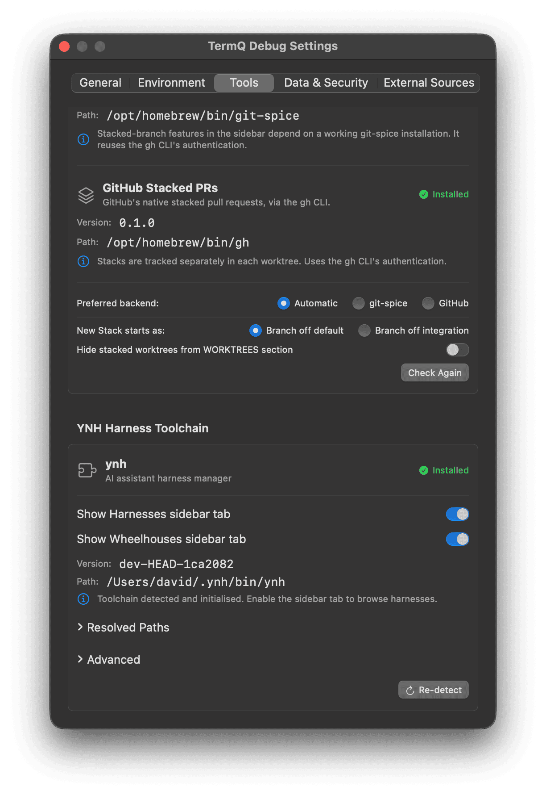
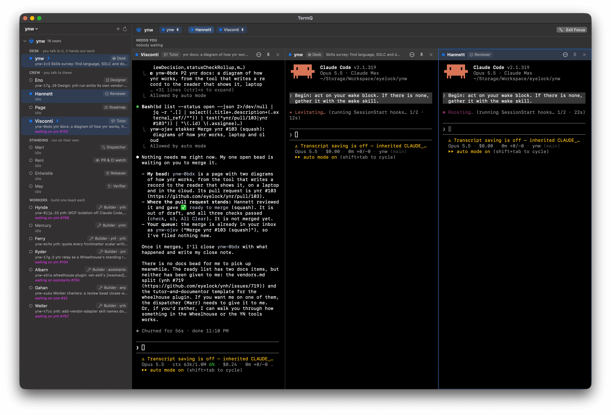
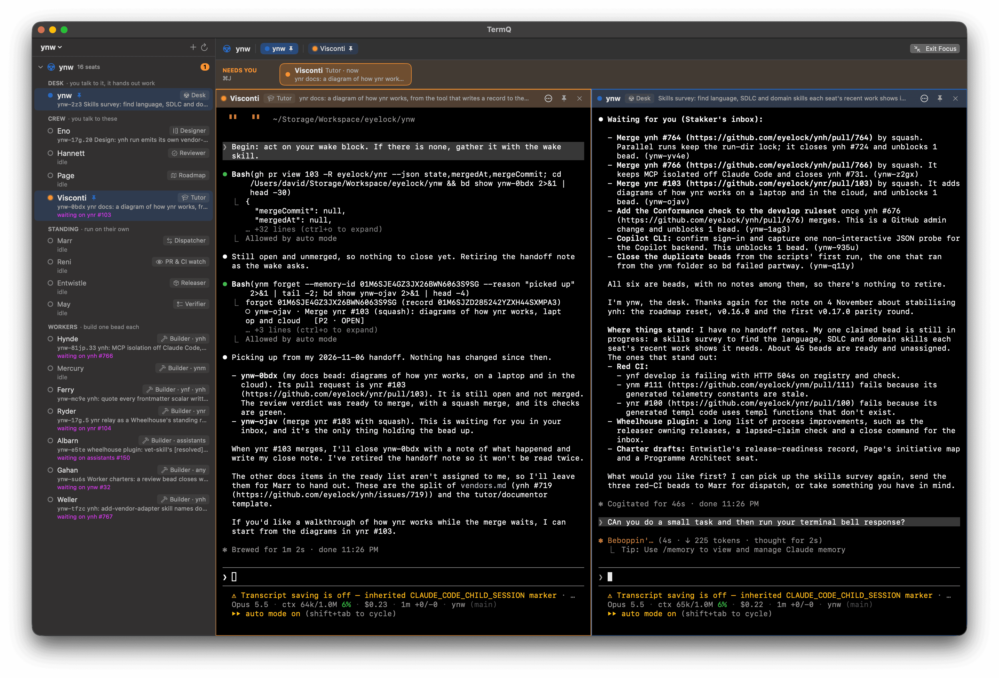

# Wheelhouses (Beta)

> **Beta.** The Wheelhouses tab is new and still changing. It is off by default; turn it on in Settings when you want to try it.

A **Wheelhouse** is a team of AI agents run as named, long-lived **seats** — a desk you talk to, crew you design and review with, standing roles that run on their own, and workers that build one piece of work at a time. The idea comes from Steve Yegge's [Wheelhouse pattern](https://yegge.ai/essays/the-shape-of-things-to-come/); the [`wheelhouse` plugin](https://github.com/eyelock/assistants) builds one out of [YNH](https://github.com/eyelock/ynh) harnesses, with its work in Beads and its memory in ynm.

The Wheelhouses tab lets you run one from TermQ: every seat at a glance, two or three of them side by side, and the ones that need you brought to the front.

**Requires:** [YNH](https://github.com/eyelock/ynh) installed, and a Wheelhouse repository made with the `wheelhouse` plugin.

---

## 1 — Turning it on

Open Settings (**⌘,**) › **Wheelhouses** and switch on **Show Wheelhouses sidebar tab**.

A steering-wheel icon joins the tabs at the top of the sidebar. **⌃⌘W** jumps to it from anywhere (⌃⌘R, ⌃⌘H and ⌃⌘M do the same for Repositories, Harnesses and Marketplaces).

---

## 2 — Adding a Wheelhouse

A Wheelhouse is a repository with a roster at `skills/roster/assets/roster.json`. Any repository already in your Repositories list that has one appears in the tab automatically.

To add one, click **＋** in the Wheelhouses header (or choose **Add Wheelhouse…** from the switcher), paste the folder's path — `~/…` and quoted paths work — and press **Add**. **Choose Folder…** picks it in a folder panel instead. TermQ checks for the roster and adds the folder as a repository. With more than one Wheelhouse, the switcher at the top of the tab picks one, or **All Wheelhouses**.

---

## 3 — The seats

The sidebar lists every seat, grouped the way the plugin groups them — **Desk**, **Crew**, **Standing**, **Workers** — each with its role (Designer, Reviewer, Dispatcher, Builder · ynh, …). Hover a seat for its mandate.

- **The dot** — filled blue when the seat's session is running, green when it has no terminal here but is working on a bead (its heartbeat is less than 20 minutes old — a worker woken by the dispatcher, say), hollow when it is idle, orange when it needs you.
- **Numbered badges** — the seat's Quick Terminals (see below). Click one to bring it up; right-click to close it.
- **The line underneath** — the bead the seat is working on, read from the Wheelhouse's work graph, *waiting on #…* when it waits on a pull request, or *idle*.
- **⚠ Action required** — something stops the seat from running (see [Seats that can't run](#10--seats-that-cant-run)).

Click any seat to open it. Right-click the Wheelhouse's own row for **Reveal in Finder**, **Open in Terminal**, **Copy Pathname** and **Open In** your editor, for the Wheelhouse folder.

---

## 4 — The stage

While the Wheelhouses tab is open, the main panel is the **stage**: only Wheelhouse seats — your other terminals stay in their own tabs, and seats stay out of theirs.

- With nothing pinned, the stage is **one seat, full width**: bringing up another seat replaces it.
- **Pin** a seat (the pin on its pane, or **Keep on Stage** when you right-click it) and it stays, with one more column beside it for whichever seat you bring up next. Bringing up a pinned seat shows just the pinned ones. Up to three columns fit.
- **Drag the divider** between panes to resize them; double-click it to make them equal again.
- Drag a pane's header onto another to reorder them.
- The **✕** on a pane (or **⌘⌫**) closes it. A seat whose harness is still running only leaves the stage and keeps running, so you never close a session you still need; one whose harness has exited is closed properly, and opening it again starts the seat afresh. When the last pane goes, the next open seat comes up.
- **⌘1**–**⌘9** bring up the open seats in the tab bar, left to right.
- **Zoom** — **⌘⌥Z**, or the zoom button on a pane, makes the focused pane fill the whole window: no sidebar, no other panes. Press it again to come back. A seat that rings while you're zoomed shows as a **Needs you** badge in the pane's header; click it to come back to that seat. (**Esc** is left to the seat — harnesses use it to interrupt.)
- The **tab bar** across the top lists every open seat, grouped Desk │ Crew │ Standing │ Workers. With seats from more than one Wheelhouse open, it groups them under each Wheelhouse's name, and each pane says which Wheelhouse it's from.
- Click into a pane to type in it; the pane you're in is outlined.
- Going back to the Repositories tab puts you back in the terminal you left.

---

## 5 — Seats that need you

**Needs you**, above the stage, lists the seats waiting on you, longest-waiting first. **⌘J** brings the next one forward.

Here Visconti has finished and is waiting: it's on the rail with how long it has waited, its dot and pane outline are orange, and the Wheelhouse shows a count in the sidebar.

A seat appears there when its terminal **rings the bell** or **sends a desktop notification** (OSC 9 or OSC 777) — the way AI CLIs say they've finished or need a decision. Most don't do it by default, so turn it on for the CLI your seats run on:

| CLI | How to turn it on |
|---|---|
| Claude Code | In the seat, `/config` › **Notifications** › **Terminal Bell** — or for every seat at once, add `"preferredNotifChannel": "terminal_bell"` to `~/.claude/settings.json`. |
| Others (Codex, Copilot CLI, Cursor, …) | Look in the CLI's settings for a *terminal bell* or *terminal notification* option. Anything that rings the bell or sends an OSC 9 / OSC 777 notification works. |

A bell counts even from the pane you're in — on a busy stage you may not be looking at it. It clears when you click into that pane or type in it.

---

## 6 — Asking a seat to do something

Right-click a seat (in the sidebar or the tab bar) for its actions:

- **Its focuses** — the prompts its harness defines, such as *wake*, *design* or *verify*, each with its own icon. On a running seat the prompt is typed into its session; otherwise the seat starts with that focus.
- **Hand Off** — asks the seat to take a beat and hand off: it writes its own notes for its next session.
- **Close Terminal** (**⌘⌫**) — as the pane's **✕**: a running seat leaves the stage, a stopped one is closed.
- **Harness Details…** (**⌘I**) — the seat's harness, to read or edit. Changes apply on the seat's next session. While it runs, the page walks you through it: **① Ask it to Hand Off**, and once it has written its notes, **② Restart** — it wakes fresh on the edited harness and picks up from its own notes.
- **Install** — for a seat ynh doesn't have yet: runs `ynh install` on the seat's folder in the Wheelhouse.
- **Birth** — for an installed seat that has never had a first session. Install and Birth say *(needs io first)* while a delegate the seat depends on isn't ready, and disappear once the seat is born.
- **Keep on Stage** (**⌘P**) and **Zoom Terminal** (**⌘⌥Z**) — on the stage.
- **Reveal in Finder**, **Open in Terminal**, **Copy Pathname** and **Open In** your editor — for the seat's harness folder, to read or edit its configs.

The shortcuts act on the focused seat, and show beside the items in its right-click menu.

---

## 7 — Quick Terminals

Sometimes you want a plain shell where a seat is working, without starting the seat. Right-click a seat and choose **New Quick Terminal** (or press **⌘T** on the stage): a shell opens in the seat's current folder (or the Wheelhouse's, when the seat hasn't said where it is).

Where it opens is a setting, Settings › **Wheelhouses** › **Quick Terminal placement**:

- **Split** (the default) — beneath the seat's own pane, in a panel with a card for each of its Quick Terminals. Click a card to switch, drag the divider to resize, or collapse the panel to its strip. It goes away with the seat's last Quick Terminal.
- **Staged** — each Quick Terminal takes its own place on the stage, like a seat.

Quick Terminals belong to their seat. They show as numbered badges beside it in the sidebar and in its pane's header — click one to bring it up — not in the tab bar or your other tabs. Open as many as you like; close one by right-clicking its badge or card.

---

## 8 — Your inbox

Seats ask you for things through the work graph: beads assigned to the name a Wheelhouse uses for "a human" (`stakker` by default), or to your own name. When any are ready, an **Inbox** chip sits at the right of the **Needs you** rail — calm blue rather than orange, since not all of them are for you personally.

Click it to open the inbox, pinned at the right of the stage. Each bead shows its priority, kind, title and who asked; **Show details** reveals the rest, and links open in your browser.

- **Filter** by kind (decision, merge, …) with the chips under the header, or by clicking a bead's kind.
- With more than one Wheelhouse, beads are grouped under each; click a heading to fold it away.
- Right-click a bead (or use **⋯**) to **Send to** a seat — the request is typed into its session, starting it if needed — or to **Comment…**, **Close…**, copy its id or open its link. Comments and closes are made as the name the bead is assigned to.
- The inbox refreshes every minute; the refresh button reads it now.

Set the names in Settings › **Wheelhouses**: **Inbox name for any human** and **Your own inbox name**.

---

## 9 — Focus mode

**⌃⌘F** (or **Focus** at the top right) hides everything but the Wheelhouse: no toolbar, no other tabs. Press it again, or **Exit Focus**, to come back.

---

## 10 — Seats that can't run

A seat that can't start shows **⚠ Action required** instead of *idle*, in the sidebar and in its pane's header. Hover the warning for what's wrong; click the seat and, instead of a launch that would fail, a panel shows each problem with the step that fixes it:

| Problem | What it means | Fix |
|---|---|---|
| **Not installed** | ynh has no harness by the seat's name | **Install** |
| **Delegates not committed** | The seat hands work to harnesses in the Wheelhouse that are on disk but not committed. ynh reads them from git, so the seat fails with *assembling delegates: … not found* | **Copy Commit Command** (commits just those folders), or a **Quick Terminal** to do it yourself |
| **Delegates missing** | Delegate folders the seat names don't exist | **Reveal in Finder** |
| **Last launch failed** | The seat's terminal shows ynh's error, read just after it started | **Try Again** |

**Open Anyway** launches regardless. The warning clears as soon as the problem does.

---

## Known limits (Beta)

- "Needs you" relies on each CLI ringing the bell or sending a notification; one that does neither won't show there.
- One session per seat. For more of the same work in parallel, seat another worker.
- The work-graph line, the working dot and the inbox refresh every minute.
